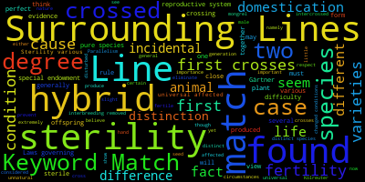

# Assignment #1 Master File
### The objective of this file is to show the responses to Assignment #1. Additional files will be included in this folder if relevant to question responses.
## Question #1 Response:
## Part A:
### To complete this portion of the assignment, I used the following commands in Bash

  ```bash

cd 'C:\Users\Alexei Clark\Documents\IntroCompBiol\IntroBiolComp-2026\IntroBiolComp-2026\IBC_2026_Student\Assignments\Assignment1'
git pull

```

### The first command declares the location of the relevant local directory, and the second command updates the local directory to contain the contents of Assignment #1 in the class directory, located on GitHub.

## Part B:
### To complete this portion of the assignment

  ```bash
grep -n '^"8[[:space:]]' Gesquiere2011_data.csv
grep -n '^"22[[:space:]]' Gesquiere2011_data.csv
```
### Individual 8 was sampled 17 times. Individual 22 was sampled 5 times.

### The first command (grep) searches for any words that start with an 8, as indicated by the "^" character, and end with spaces, indicated by the "[[:space:]]" syntax. This ensures that only line numbers (-n) with 8 in the first column are chosen, rather than line numbers with 8 in any position, such as 80. This is applicable to individual 22 as well.

## Part C:
### To complete this portion of the script, Python was used. The script is as follows:

  ```python
# Allows for arguments to be accessed from terminal
import sys

# The filename and ID are inputted on the command line
filename = sys.argv[1] # Declare first argument
target_id = sys.argv[2] # Declare second argument

count = 0

# With loop to open and read file
with open(filename, 'r') as f:
    for line in f:
        # Strip each line and split it by spaces
        columns = line.strip().split()
        
        # Compare the first column to the target ID
        if columns[0] == target_id:
            count += 1 # Continue the loop

# Print the overall count
print(count)
```
### To complete this script, sys was imported to allow for arguments to be accessed from the terminal. An argument was declared for the filename and target_id. Using a while loop, each line was stripped and split based on the presence of spaces, denoting each line. This loop was set to repeat until all relevant lines in the CSV file were counted.

### To display the number of lines in each sample, the following must be typed into bash:

  ```bash
python python_file_name.py data_set.csv target_id
```

### For example, entering the following code would display 17, as confirmed by the previous question's answer.

  ```bash
python Assignment1c_Final.py Gesquiere2011_data.csv '"8'
```

## Part D:
### To complete this portion of the script, only python was used, not bash. The code is as follows:

  ```python
# Create an empty dictionary to store counts
counts = {}

# Open and read the data file
with open(r"C:\Users\Alexei Clark\Documents\IntroCompBiol\IntroBiolComp-2026\IntroBiolComp-2026\IBC_2026_Student\Assignments\Assignment1\Gesquiere2011_data.csv", "r") as x:
  for line in x: # For loop
      # Use split() to automatically handle tabs and spaces in the file
      columns = line.strip().split()
      
      if columns:
          # Remove any accidental quotes and grab the first column
          ind_id = columns[0].strip('"\'') 
          
          # Skip the header row ("maleID") or any non-numeric rows safely
          if ind_id == "maleID" or not ind_id.isdigit():
              continue
              
          # Count the occurrences of each ID
          if ind_id in counts:
              counts[ind_id] += 1 # If a repeated ID occurs, then it is cumulatively added to the count
          else:
              counts[ind_id] = 1 # The count is initialized

# Save the results into a new CSV file
with open(r"C:\Users\Alexei Clark\Documents\IntroCompBiol\IntroBiolComp-2026\IntroBiolComp-2026\IBC_2026_Student\Assignments\Assignment1\Num_samples.csv", "w", newline="") as x:
  x.write("maleID,sample_count\n")
  
  # Sort the IDs numerically
  for ind_id in sorted(counts.keys(), key=int): # Forces python to treat all values as integers
      count = counts[ind_id]
      x.write(f"{ind_id},{count}\n") # Writes the individual ID and its count
```

### This script creates an empty dictionary before reading the Gesquiere2011_data.csv file. A for loop is nested within a while loop, which ultimately identifies the column formatting of the initial CSV file and establishes the first column, ind_id. Irrelevant information is skipped over; maleID is not factored into the overall counts, but the ind_id is placed into an if loop to constantly check for repeats. For each repeat identified, 1 is added to the cumulative count value. If no more repeats are discovered, the if loop stops. Finally, a new CSV file (Num_samples.csv) is created to display the MaleID and associated sample counts for each individual.

## Question 2 Response:
## Part A:
### To complete this task, the following was typed into bash:
  ```bash
curl -o origin.txt https://www.gutenberg.org/cache/epub/1228/pg1228.txt
```

### This task simply downloaded a text version of Darwin's _On the Origin of Species by Means of Natural Selection_

## Part B:
### To complete this task, the following code was used:

  ```python
# Open the file in binary mode (rb). This is to allow the code to read any unorthodox characters.
with open(r"C:\Users\Alexei Clark\Documents\IntroCompBiol\IntroBiolComp-2026\IntroBiolComp-2026\IBC_2026_Student\Assignments\Assignment1\origin.txt", "rb") as f:
  text = f.read().lower() # Reads the text in only lowercase letters. This is to get around the case requirements.

# Since binary mode uses the byte object, the prefix b must be placed in front of any terms that are to be searched
sterility_count = text.count(b"sterility")
isolation_count = text.count(b"isolation")

# Variables must explicitly be considered strings to ensure variable uniformity
print(f"The word 'sterility' appears " + str(sterility_count) + " times.")
print(f"The word 'isolation' appears " + str(isolation_count) + " times.")
```

### "Sterility" occurs 97 times. "Isolation" occurs 12 times.

### The file was opened in binary mode to account for any unexpected characters, ensuring that it is readable by the computer. Additionally, the text was read in lowercase letters to prevent case sensitivity from changing the result. The counts for "sterility" and "isolation" were simply stored as variables and printed.

## Part C:
### To complete this task, the following python code was used:

  ```python
file_path = r"C:\Users\Alexei Clark\Documents\IntroCompBiol\IntroBiolComp-2026\Assignment1\origin.txt"
output_path = r"C:\Users\Alexei Clark\Documents\IntroCompBiol\IntroBiolComp-2026\Assignment1\sterility_output.txt"

# Open the file in binary mode (rb) to read text and split into lines
with open(file_path, "rb") as f:
    binary_content = f.read()

# Convert a lowercase version of the whole text for counting
text = binary_content.lower()

# Since binary mode uses the byte object, the prefix b must be placed in front of terms
sterility_count = text.count(b"sterility")
isolation_count = text.count(b"isolation")

# Search for 3 lines before and after sterility
keyword = b"sterility"

# Open an output file to save your results
with open(output_path, "w", encoding="utf-8") as out:

    # For loop to track index i, which indexes every line in the origin.txt file
    for i in range(len(lines)):
        line = lines[i]
        
        # Check if the lowercase version of the line contains your keyword
        if keyword in line.lower():
            match_msg = f"A match was found at line {i + 1}\n"
            print(match_msg.strip())
            out.write(match_msg)
            
            # Define the range: 3 lines before (start) to 3 lines after (end)
            start = max(0, i - 3) # 0 prevents a negative number, i-3 refers to three lines earlier
            end = min(len(lines), i + 4) # Slicing stops right before line 4, so the next three lines are displayed
            
            # For loop for j in range of start and end parameters
            for j in range(start, end):
                # Decodes strings safely from binary (utf-8 formatting) with error replacement
                decoded_line = lines[j].decode('utf-8', errors='replace').rstrip()

                # Prints that a keyword match is found when j is exactly equal to i, but for all other values in the range, they are denoted as surrounding lines
                if j == i:
                    ster_file = f"Keyword Match ({j + 1}): {decoded_line}\n"
                else:
                    ster_file = f"Surrounding Lines ({j + 1}): {decoded_line}\n"
                
                print(ster_file.strip())
                out.write(ster_file)
                
            divider = "-" * 40 + "\n" # Prints "-" 40 times to delineate results
            print(divider.strip()) # Divider separates by spaces
            out.write(divider) # Writes divider into results

# Output path changed
output_path = r"C:\Users\Alexei Clark\Documents\IntroCompBiol\IntroBiolComp-2026\Assignment1\isolation_output.txt"

# Search for 3 lines before and after isolation
keyword = b"isolation"

# Open an output file to save your results
with open(output_path, "w", encoding="utf-8") as out:

    # For loop to track index i, which indexes every line in the origin.txt file
    for i in range(len(lines)):
        line = lines[i]
        
        # Check if the lowercase version of the line contains your keyword
        if keyword in line.lower():
            match_msg = f"A match was found at line {i + 1}\n"
            print(match_msg.strip())
            out.write(match_msg)
            
            # Define the range: 3 lines before (start) to 3 lines after (end)
            start = max(0, i - 3) # 0 prevents a negative number, i-3 refers to three lines earlier
            end = min(len(lines), i + 4) # Slicing stops right before line 4, so the next three lines are displayed
            
            # For loop for j in range of start and end parameters
            for j in range(start, end):
                # Decodes strings safely from binary (utf-8 formatting) with error replacement
                decoded_line = lines[j].decode('utf-8', errors='replace').rstrip()

                # Prints that a keyword match is found when j is exactly equal to i, but for all other values in the range, they are denoted as surrounding lines
                if j == i:
                    isol_file = f"Keyword Match ({j + 1}): {decoded_line}\n"
                else:
                    isol_file = f"Surrounding Lines ({j + 1}): {decoded_line}\n"
                
                print(isol_file.strip())
                out.write(isol_file)
                
            divider = "-" * 40 + "\n" # Prints "-" 40 times to delineate results
            print(divider.strip()) # Divider separates by spaces
            out.write(divider) # Writes divider into results
```

### Although lengthy, it essentially performs the same function twice: One for each word. After indexing each portion of the origin.txt file, the specific keyword is searched for. Additional parameters are specified to define that three lines before and after the keyword are to be included. These specifications are printed and included in appropriately labeled text files, sterility_output and isolation_output.

## Part D:
### To install conda, the following was typed into the Anaconda Prompt:
  ```Conda
conda install conda-forge::wordcloud
```
### To generate the word cloud for "sterility," the following code was typed into the command line:
  ```Conda
wordcloud_cli --text "C:\Users\Alexei Clark\Documents\IntroCompBiol\IntroBiolComp-2026\Assignment1\sterility_output.txt" --imagefile "C:\Users\Alexei Clark\Documents\IntroCompBiol\IntroBiolComp-2026\Assignment1\sterility_wordcloud.png"
```
### The output for this image is as follows:


### It should be noted that some words, such as "Surrounding Lines," "Keyword Match," and "Line," are observed simply because they were added by my previous script to denote the presence of the word "sterilization" in addition to the surrounding lines.

### To generate the word cloud for "isolation," the following code was typed into the command line:
  ```Conda
wordcloud_cli --text "C:\Users\Alexei Clark\Documents\IntroCompBiol\IntroBiolComp-2026\Assignment1\isolation_output.txt" --imagefile "C:\Users\Alexei Clark\Documents\IntroCompBiol\IntroBiolComp-2026\Assignment1\isolation_wordcloud.png"
```
### The output for this image is as follows:


### The same discrepancies that were previously noted should be applied to this wordcloud too.

## Part E:
### Based explicitly on the word clouds, I agree with the claim that Darwin did not address processes that lead to the formation of new species. In the sterility word cloud, it is shown that Darwin contrasted sterility with fertility, which are core distinctions between organisms that are and aren't part of the same species, but this doesn't necessarily indicate an adequate explanation for depicting speciation. Furthermore, in the isolation word cloud, greater emphasis is placed on favorability and natural selection-like terms, rather than on terms that explain speciation. From explicitly analyzing the abundance of particular terms in the lines surrounding instances of "isolation" or "sterilization," there is not sufficient evidence that Darwin connected his hypotheses to the process of speciation.

## Question 3:
### To complete this question, the following code was used:

  ```python
# Displays two lists: One to represent the 12 days of Christmas, and one to represent all of the gifts.
days = [
    "First", "Second", "Third", "Fourth", "Fifth", "Sixth",
    "Seventh", "Eighth", "Ninth", "Tenth", "Eleventh", "Twelfth"
]

gifts = [
    "A Partridge in a Pear Tree",
    "Two Turtle Doves",
    "Three French Hens",
    "Four Colly Birds",
    "Five Gold Rings",
    "Six Geese-a-Laying",
    "Seven Swans-a-Swimming",
    "Eight Maids-a-Milking",
    "Nine Ladies Dancing",
    "Ten Lords-a-Leaping",
    "Eleven Pipers Piping",
    "Twelve Drummers Drumming"
]

# Describes the days from index 0 to 11 (the 12 days of Christmas)
for i in range(len(days)):
    print(f"On the {days[i]} Day of Christmas, my true love sent to me:") # Prints index value for days, starting with "first"
    
    # Counts backward from the current day down to 0
    for j in range(i, -1, -1): # Ensures that the loop stops at index 0 and that the step size is down one
        # Add "And" before the partridge on the verse following the first one
        if i > 0 and j == 1:
            print(f"{gifts[j]}, and") # Displays gifts in descending order, starting with the newest gift of the present day
        else:
            print(gifts[j]) # On the first day, only the initial gift is displayed
            
    # Add a blank space between verses
    print("\n")
```

### The previous code utilizes nested loops to display the elements of the days[] and gifts[] lists in a particular order. The outermost loop keeps track of the days, and the next loop counts elements in both lists backwards, stopping at the first element. The innermost loop adds an "and" at the end of the second-to-last item in the list. A blank space is added to separate verses too.

## Question 4:
### The following Bash commands were used to upload my files:

  ```bash
# Declare my directory. This filepath appears slightly different from earlier filepaths due to manual rearrangement of my local directory to be compatible with a Git Push.
cd "/c/Users/Alexei Clark/Documents/IntroCompBiol/IntroBiolComp-2026/IntroBiolComp-2026/IBC_2026_Student"

# Confirm that I'm pushing my local directories to this GitHub account
git remote set-url origin https://github.com/aclark1816/IBC_2026_Student.git

git add -A # States all changes made
git commit -m "Upload Assignment 1 files" # Commits to local Git history
git push origin main # Commits to main branch of Github repository
```
### The first two commands were done to declare my directory and confirm my remote repository to ensure that the files are pushed to the correct position. The last three commands simply save all new changes made, commit them to the local Git history, and push them onto the Github repository.
